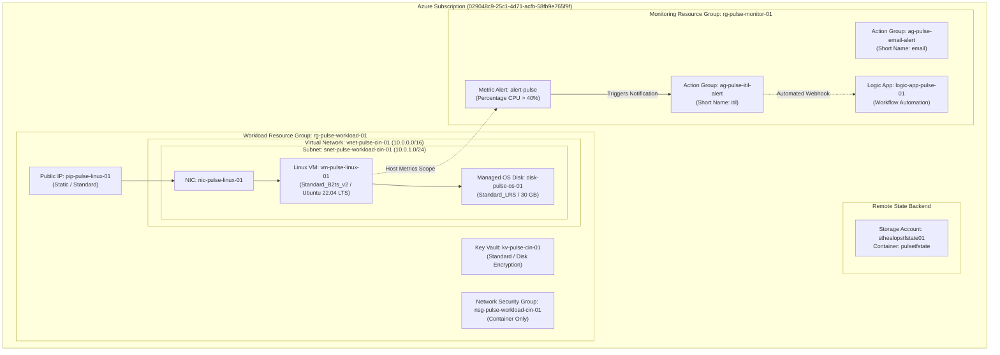
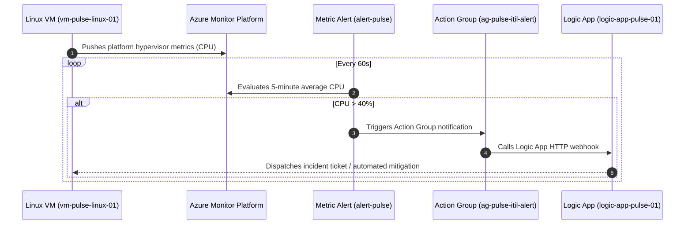

# Project Pulse: Enterprise Azure Cloud Infrastructure

[](https://www.terraform.io/)
[](https://registry.terraform.io/providers/hashicorp/azurerm/latest)
[](https://azure.microsoft.com/en-us/global-infrastructure/geographies/#geographies)
[](#)

Enterprise Infrastructure-as-Code (IaC) repository for **Project Pulse**, provisioning a secure, modular cloud foundation in Microsoft Azure using HashiCorp Terraform.

---

## 📚 Architecture Documentation Index

Comprehensive engineering specifications, system flows, and observability architectures are cataloged in the dedicated architecture directories:

| Document | Description | Direct Links |
| :--- | :--- | :--- |
| **High-Level Design (HLD)** | Complete platform design, physical/logical hierarchy, network, security, and risk analysis. | [documentation/architecture/azure-high-level-design.md](documentation/architecture/azure-high-level-design.md)<br/>[architecture/azure-high-level-design.md](architecture/azure-high-level-design.md) |
| **Observability Architecture** | Azure Monitor workflow, metric alerts, action groups, logic apps, and gap analysis. | [documentation/architecture/monitoring-observability-design.md](documentation/architecture/monitoring-observability-design.md)<br/>[architecture/monitoring-observability-design.md](architecture/monitoring-observability-design.md) |
| **System Diagrams** | Standalone Mermaid diagrams for topology, segmentation, alerts, and sequence flows. | [documentation/architecture/diagrams.md](documentation/architecture/diagrams.md)<br/>[architecture/diagrams.md](architecture/diagrams.md) |

---

## 🏛️ Infrastructure Architecture Overview

The platform is deployed in **Central India** across two purpose-built resource groups, separating core workload processing from management and monitoring planes:



---

## 📋 Key Azure Resources (Implementation Inventory)

The following inventory details all live resources managed by Terraform in this codebase:

| Resource Category | Azure Resource Type | Identifier / Resource Name | Resource Group | Key Specifications |
| :--- | :--- | :--- | :--- | :--- |
| **Resource Group** | `azurerm_resource_group` | `rg-pulse-workload-01` | Subscription Root | Location: `Central India` |
| **Resource Group** | `azurerm_resource_group` | `rg-pulse-monitor-01` | Subscription Root | Location: `Central India` |
| **Virtual Network** | `azurerm_virtual_network` | `vnet-pulse-cin-01` | `rg-pulse-workload-01` | Address space: `10.0.0.0/16` |
| **Subnet** | `azurerm_subnet` | `snet-pulse-workload-cin-01` | `rg-pulse-workload-01` | Prefix: `10.0.1.0/24` |
| **Network Security**| `azurerm_network_security_group`| `nsg-pulse-workload-cin-01`| `rg-pulse-workload-01` | Standalone NSG container |
| **Public IP** | `azurerm_public_ip` | `pip-pulse-linux-01` | `rg-pulse-workload-01` | Static allocation, Standard SKU |
| **Network Interface**| `azurerm_network_interface`| `nic-pulse-linux-01` | `rg-pulse-workload-01` | Dynamic Private IP, attached to PIP |
| **Compute VM** | `azurerm_linux_virtual_machine` | `vm-pulse-linux-01` | `rg-pulse-workload-01` | `Standard_B2ts_v2`, Canonical Ubuntu 22.04 LTS |
| **OS Storage** | `azurerm_managed_disk` | `disk-pulse-os-01` | `rg-pulse-workload-01` | `Standard_LRS`, `ReadWrite` caching |
| **Key Vault** | `azurerm_key_vault` | `kv-pulse-cin-01` | `rg-pulse-workload-01` | Standard SKU, Soft delete 7d, Purge off |
| **Action Group** | `azurerm_monitor_action_group` | `ag-pulse-email-alert` | `rg-pulse-monitor-01` | Notification container (Email) |
| **Action Group** | `azurerm_monitor_action_group` | `ag-pulse-itil-alert` | `rg-pulse-monitor-01` | Notification container (ITIL / Ticketing) |
| **Serverless Logic**| `azurerm_logic_app_workflow` | `logic-app-pulse-01` | `rg-pulse-monitor-01` | Consumption plan workflow |
| **Metric Alert** | `azurerm_monitor_metric_alert` | `alert-pulse` | `rg-pulse-monitor-01` | CPU > 40%, Window: PT5M, Frequency: PT1M |

---

## 🔒 Network & Security Posture

* **Network Isolation:** Private workload resides within `snet-pulse-workload-cin-01` (`10.0.1.0/24`).
* **Ingress Access:** A static Standard Public IP is directly bound to the VM's Network Interface.
* **Encryption at Rest:** Azure-managed keys encrypt OS disk volumes; Key Vault is enabled for disk encryption access.
* **Secrets Management:** `kv-pulse-cin-01` provisioned with tenant-scoped authentication dynamically sourced via client configuration.

---

## 📈 Azure Monitor & Alerting Workflow

The system provides autonomous infrastructure health alerting:



---

## 🚀 Deployment Sequence & Execution Flow

The architecture follows a strict 7-tier deployment sequence. Dependencies are managed via explicit `depends_on` blocks in [`Enviroments/dev/main.tf`](Enviroments/dev/main.tf):

1. **Tier 1 - Base Foundation:** Resource Groups (`rg-pulse-workload-01`, `rg-pulse-monitor-01`).
2. **Tier 2 - Network Foundation:** Virtual Network (`10.0.0.0/16`) and Subnet (`10.0.1.0/24`).
3. **Tier 3 - Network Security:** Network Security Group (`nsg-pulse-workload-cin-01`).
4. **Tier 4 - Public Connectivity:** Static Standard Public IP (`pip-pulse-linux-01`).
5. **Tier 5 - Secrets & Encryption:** Azure Key Vault (`kv-pulse-cin-01`).
6. **Tier 6 - Compute Workloads:** Linux Virtual Machine (`vm-pulse-linux-01`) and OS Disk.
7. **Tier 7 - Monitoring & Observability:** Action Groups, Logic App Workflow, and Metric Alerts.

### Executing Terraform Commands

All commands are run from the environment directory:

```bash
cd Enviroments/dev

# 1. Initialize backend and child modules
terraform init

# 2. Format and validate syntax
terraform fmt -recursive
terraform validate

# 3. Generate and inspect execution plan
terraform plan

# 4. Apply configuration to Azure
terraform apply
```

---

## ⚠️ Infrastructure Gaps & Hardening Recommendations

The following items are identified from the code audit as recommended production improvements:

1. **Network Security Association:** The NSG `nsg-pulse-workload-cin-01` is not currently bound to `snet-pulse-workload-cin-01`. An `azurerm_subnet_network_security_group_association` should be added to secure inbound traffic.
2. **SSH Key Authentication:** The VM currently uses password authentication with plain text in `.auto.tfvars`. Transitioning to `admin_ssh_key` is strongly recommended.
3. **Log Analytics Workspace:** A central `azurerm_log_analytics_workspace` and `azurerm_monitor_diagnostic_setting` are needed to capture VM syslog, Key Vault audit events, and network logs.
4. **Action Group Endpoints:** Populate `email_receiver` and `logic_app_receiver` inside `modules/action_group` so alert notifications reach human responders and automated runbooks.
