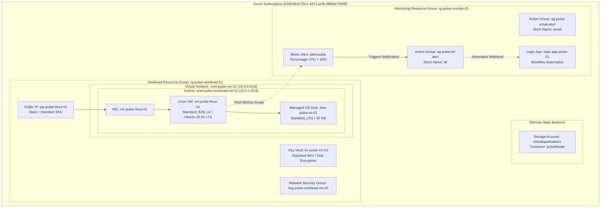
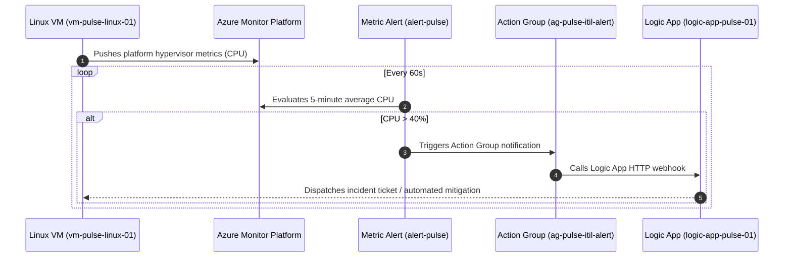

# Project Pulse: Enterprise Azure Cloud Infrastructure

[](https://www.terraform.io/)
[](https://registry.terraform.io/providers/hashicorp/azurerm/latest)
[](https://azure.microsoft.com/en-us/global-infrastructure/geographies/#geographies)
[](#)

A demonstration of production-grade cloud engineering and Infrastructure as Code (IaC) in **Microsoft Azure**, built with **HashiCorp Terraform**.

---

## 🎯 Project Objectives & Highlights

This project showcases a production-ready, hands-on implementation of core cloud architecture patterns:

* **Modular IaC Architecture:** 100% modular design with reusable child modules (`modules/`) separating compute, networking, security, storage, and monitoring.
* **Resilient Remote State:** Remote state backend hosted on Azure Blob Storage with automated lease-based state locking.
* **Separation of Concerns:** Purpose-driven resource groups isolating workload resources (`rg-pulse-workload-01`) from observability infrastructure (`rg-pulse-monitor-01`).
* **Integrated Observability Pipeline:** Native integration linking Linux compute metrics directly to Azure Monitor Metric Alerts, multi-tier Action Groups, and automated Logic App workflows.
* **Zero Hardcoding:** Dynamic data lookups via `data.tf` and clean map iterations using `for_each` and domain-split `.auto.tfvars`.

---

## 📚 Architecture Documentation Index

Comprehensive engineering specifications, system flows, and observability architectures are cataloged in the dedicated architecture directories:

| Document | Primary Focus | Direct Links |
| :--- | :--- | :--- |
| **High-Level Design (HLD)** | Complete platform design, physical/logical hierarchy, network topology, and security plane. | [architecture/azure-high-level-design.md](architecture/azure-high-level-design.md)<br/>[documentation/architecture/azure-high-level-design.md](documentation/architecture/azure-high-level-design.md) |
| **Observability Architecture** | Azure Monitor workflow, metric alerts, action groups, and serverless Logic App integration. | [architecture/monitoring-observability-design.md](architecture/monitoring-observability-design.md)<br/>[documentation/architecture/monitoring-observability-design.md](documentation/architecture/monitoring-observability-design.md) |
| **System Diagrams** | Visual Mermaid models for topology, network segmentation, telemetry pipeline, and runtime sequence flow. | [architecture/diagrams.md](architecture/diagrams.md)<br/>[documentation/architecture/diagrams.md](documentation/architecture/diagrams.md) |

---

## 🏛️ Infrastructure Architecture Overview

The platform is deployed in **Central India** across two specialized resource groups:



---

## 📋 Deployed Azure Resource Inventory

The following table catalogs the live resources managed by Terraform in this codebase:

| Resource Category | Azure Resource Type | Identifier / Resource Name | Resource Group | Key Specifications |
| :--- | :--- | :--- | :--- | :--- |
| **Foundation** | `azurerm_resource_group` | `rg-pulse-workload-01` | Subscription Root | Location: `Central India` |
| **Foundation** | `azurerm_resource_group` | `rg-pulse-monitor-01` | Subscription Root | Location: `Central India` |
| **Networking** | `azurerm_virtual_network` | `vnet-pulse-cin-01` | `rg-pulse-workload-01` | Address space: `10.0.0.0/16` |
| **Networking** | `azurerm_subnet` | `snet-pulse-workload-cin-01` | `rg-pulse-workload-01` | Address prefix: `10.0.1.0/24` |
| **Security** | `azurerm_network_security_group`| `nsg-pulse-workload-cin-01`| `rg-pulse-workload-01` | Standalone NSG boundary |
| **Public IP** | `azurerm_public_ip` | `pip-pulse-linux-01` | `rg-pulse-workload-01` | Static allocation, Standard SKU |
| **Network Interface**| `azurerm_network_interface`| `nic-pulse-linux-01` | `rg-pulse-workload-01` | Dynamic Private IP, attached to PIP |
| **Compute VM** | `azurerm_linux_virtual_machine` | `vm-pulse-linux-01` | `rg-pulse-workload-01` | `Standard_B2ts_v2`, Canonical Ubuntu 22.04 LTS |
| **OS Storage** | `azurerm_managed_disk` | `disk-pulse-os-01` | `rg-pulse-workload-01` | `Standard_LRS`, `ReadWrite` caching |
| **Key Vault** | `azurerm_key_vault` | `kv-pulse-cin-01` | `rg-pulse-workload-01` | Standard SKU, Soft delete 7d, Disk encryption enabled |
| **Action Group** | `azurerm_monitor_action_group` | `ag-pulse-email-alert` | `rg-pulse-monitor-01` | Notification container (Email) |
| **Action Group** | `azurerm_monitor_action_group` | `ag-pulse-itil-alert` | `rg-pulse-monitor-01` | Incident management container (ITIL / Ticketing) |
| **Serverless Logic**| `azurerm_logic_app_workflow` | `logic-app-pulse-01` | `rg-pulse-monitor-01` | Consumption plan workflow |
| **Metric Alert** | `azurerm_monitor_metric_alert` | `alert-pulse` | `rg-pulse-monitor-01` | CPU > 40%, Window: PT5M, Frequency: PT1M, Auto-Mitigate |

---

## 🛠️ Reusable Terraform Module Structure

The project employs an industry-standard directory layout:

```text
healops-terraform/
├── Enviroments/
│   └── dev/
│       ├── provider.tf                   # Backend and AzureRM provider configuration
│       ├── main.tf                       # Module invocations with explicit dependencies
│       ├── data.tf                       # Dynamic data source lookups (zero hardcoding)
│       ├── variables.tf                  # Clean, sequence-tiered variable definitions
│       ├── terraform.tfvars.example      # Documented reference template for team members
│       ├── resource_group.auto.tfvars   # Foundation inputs
│       ├── network.auto.tfvars          # VNet, Subnet, and Public IP inputs
│       ├── security.auto.tfvars         # Key Vault inputs
│       ├── compute.auto.tfvars          # Linux VM and disk inputs
│       └── monitoring.auto.tfvars       # Action Groups, Logic App, and Alert inputs
├── modules/
│   ├── resource_groups/                 # Resource Group module
│   ├── virtual_network/                 # Virtual Network module
│   ├── subnet/                          # Subnet module
│   ├── network_security_group/          # NSG module
│   ├── public_ip/                       # Public IP module
│   ├── key_vault/                       # Azure Key Vault module
│   ├── linux_virtual_machine/           # Compute VM and NIC module
│   ├── action_group/                    # Azure Monitor Action Group module
│   ├── logic_app/                       # Azure Logic App module
│   └── alerts/                          # Azure Monitor Metric Alert module
├── architecture/                        # Core architecture documentation
└── documentation/architecture/          # Comprehensive design specifications
```

---

## 📈 Azure Monitor & Alerting Workflow

The system provides autonomous infrastructure health alerting:



---

## 🚀 Deployment Sequence & Execution Flow

The architecture follows a strict 7-tier deployment order managed via explicit `depends_on` blocks in [`Enviroments/dev/main.tf`](Enviroments/dev/main.tf):

1. **Tier 1 - Base Foundation:** Resource Groups (`rg-pulse-workload-01`, `rg-pulse-monitor-01`).
2. **Tier 2 - Network Foundation:** Virtual Network (`10.0.0.0/16`) and Subnet (`10.0.1.0/24`).
3. **Tier 3 - Network Security:** Network Security Group (`nsg-pulse-workload-cin-01`).
4. **Tier 4 - Public Connectivity:** Static Standard Public IP (`pip-pulse-linux-01`).
5. **Tier 5 - Secrets & Encryption:** Azure Key Vault (`kv-pulse-cin-01`).
6. **Tier 6 - Compute Workloads:** Linux Virtual Machine (`vm-pulse-linux-01`) and OS Disk.
7. **Tier 7 - Monitoring & Observability:** Action Groups, Logic App Workflow, and Metric Alerts.

### CLI Commands

```bash
cd Enviroments/dev

# 1. Initialize backend and modules
terraform init

# 2. Format and validate
terraform fmt -recursive
terraform validate

# 3. Review execution plan
terraform plan

# 4. Apply configuration
terraform apply
```
