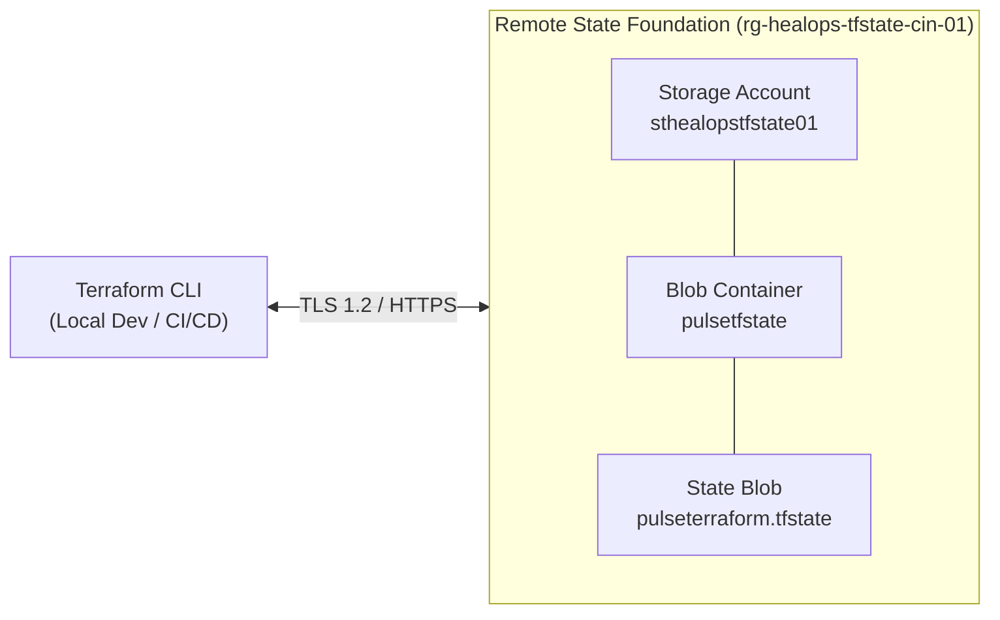
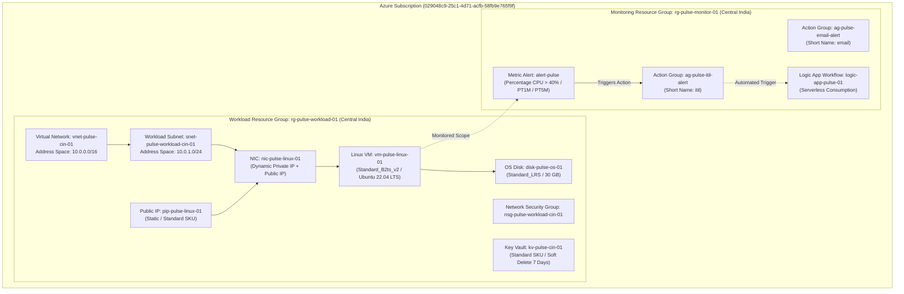
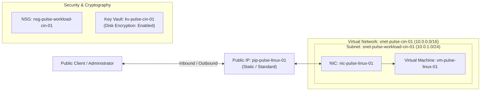
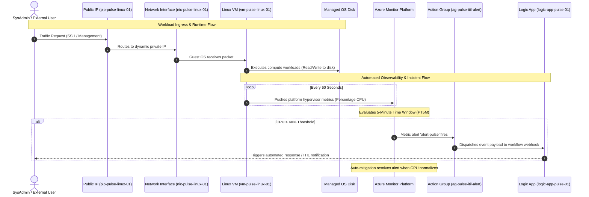
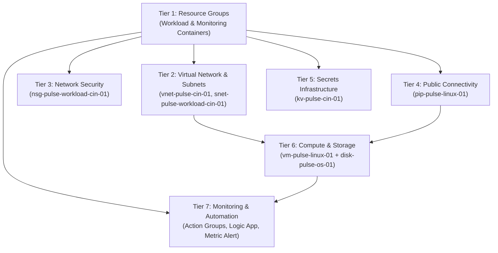

# Azure High-Level Design (HLD): Project Pulse Infrastructure

**Project Name:** Project Pulse (HealOps Cloud Platform)  
**Environment:** `dev`  
**Target Region:** Central India (`centralindia`)  
**Infrastructure as Code:** HashiCorp Terraform (`>= 1.5.0`)  
**Azure Provider:** `hashicorp/azurerm` (`~> 5.0`)  
**State Backend:** Remote Azure Storage Account with State Locking  

---

## 1. Executive Summary & Architecture Objectives

**Project Pulse** is an enterprise-grade cloud infrastructure platform engineered in Microsoft Azure using HashiCorp Terraform. Built as a hands-on demonstration of production cloud architecture patterns, the platform emphasizes:

* **Separation of Concerns:** Isolated resource groups separating application workload resources from observability and monitoring infrastructure.
* **Modular Infrastructure-as-Code (IaC):** 100% reusable, independent child modules designed with zero hardcoding, strict dependency management, and map-based iteration.
* **Resilient State Management:** Secure remote state storage backed by Azure Blob Storage with automated lease locking to prevent state corruption during concurrent operations.
* **Integrated Observability:** Native end-to-end telemetry pipeline linking compute workloads directly to Azure Monitor Metric Alerts, multi-tier Action Groups, and automated Logic App workflows.

---

## 2. Remote State Management Architecture

The Terraform deployment state is maintained remotely within an Azure-native storage architecture:

### Key Technical Attributes
* **Remote State Backend:** `azurerm` provider block in `provider.tf`.
* **State Locking:** Native Azure Blob lease mechanism prevents concurrent modifications.
* **High Durability:** Azure Storage replicates state snapshots, ensuring consistency across deployments.

---

## 3. Cloud Architecture & Infrastructure Hierarchy

The platform partitions resources logically across two specialized Resource Groups located in **Central India**:

---

## 4. Implemented Infrastructure Components

### 4.1 Resource Inventory

| Category | Module Directory | Azure Resource | Configured Resource Name | Specifications & Highlights |
| :--- | :--- | :--- | :--- | :--- |
| **Foundation** | `modules/resource_groups` | `azurerm_resource_group` | `rg-pulse-workload-01` | Centralized workload resource container in Central India |
| **Foundation** | `modules/resource_groups` | `azurerm_resource_group` | `rg-pulse-monitor-01` | Dedicated operational observability container in Central India |
| **Networking** | `modules/virtual_network` | `azurerm_virtual_network` | `vnet-pulse-cin-01` | Virtual Network with `10.0.0.0/16` CIDR space |
| **Networking** | `modules/subnet` | `azurerm_subnet` | `snet-pulse-workload-cin-01` | Dedicated workload subnet with `10.0.1.0/24` CIDR |
| **Security** | `modules/network_security_group` | `azurerm_network_security_group` | `nsg-pulse-workload-cin-01` | Network security boundary container |
| **Public IP** | `modules/public_ip` | `azurerm_public_ip` | `pip-pulse-linux-01` | Static allocation method, Standard SKU tier |
| **Compute NIC**| `modules/linux_virtual_machine` | `azurerm_network_interface` | `nic-pulse-linux-01` | Dynamic private IP with direct Standard Public IP mapping |
| **Compute VM** | `modules/linux_virtual_machine` | `azurerm_linux_virtual_machine` | `vm-pulse-linux-01` | Size: `Standard_B2ts_v2`, OS: Canonical Ubuntu Server 22.04 LTS |
| **Storage** | `modules/linux_virtual_machine` | `azurerm_managed_disk` (inline) | `disk-pulse-os-01` | `Standard_LRS` storage, `ReadWrite` caching |
| **Secrets** | `modules/key_vault` | `azurerm_key_vault` | `kv-pulse-cin-01` | Standard SKU, dynamic tenant auth, disk encryption enabled |
| **Alerting** | `modules/action_group` | `azurerm_monitor_action_group` | `ag-pulse-email-alert` | Operations notification channel (`email`) |
| **Alerting** | `modules/action_group` | `azurerm_monitor_action_group` | `ag-pulse-itil-alert` | Incident management notification channel (`itil`) |
| **Automation** | `modules/logic_app` | `azurerm_logic_app_workflow` | `logic-app-pulse-01` | Serverless orchestration workflow |
| **Monitoring** | `modules/alerts` | `azurerm_monitor_metric_alert` | `alert-pulse` | Percentage CPU > 40%, Auto-Mitigate enabled |

---

## 5. Network & Security Architecture

### Technical Highlights
1. **IP Addressing Strategy:**  
   * Dedicated `/16` network (`10.0.0.0/16`) allowing for future subnet expansion (e.g., database, private endpoints, or application gateways).
   * Contiguous `/24` subnet (`10.0.1.0/24`) isolating runtime virtual machine interfaces.
2. **Direct Public Connectivity:**  
   * The Linux host is equipped with a dedicated Static Standard Public IP address for direct administrative access and inbound traffic handling.
3. **Key Vault Integration:**  
   * Enterprise secrets vault configured with `tenant_id` populated dynamically from `data.azurerm_client_config.current.tenant_id`.
   * Pre-configured with `enabled_for_disk_encryption = true` to enable Azure Disk Encryption integration.
   * Configured with 7-day soft-delete retention protecting stored assets against accidental operational removal.

---

## 6. End-to-End Application & Telemetry Workflow

---

## 7. Infrastructure Deployment Lifecycle & Sequencing

The platform follows a clean, 7-tier deployment order. In [`Enviroments/dev/main.tf`](../../Enviroments/dev/main.tf), explicit `depends_on` relationships guarantee deterministic, repeatable provisioning:

---

## 8. Terraform Modular Design Patterns

The codebase adopts enterprise best practices:
1. **Dynamic Iteration:** Child modules utilize `for_each` over map variables, eliminating duplicated resource declarations.
2. **Dynamic Data Discovery:** Centralized in [`Enviroments/dev/data.tf`](../../Enviroments/dev/data.tf), referencing runtime resource attributes without brittle hardcoding.
3. **Domain-Specific Variable Files:** Variables are organized into clean `.auto.tfvars` files by domain (`resource_group`, `network`, `security`, `compute`, `monitoring`), avoiding monolithic variable files.
4. **Zero-Destruction Stability:** Network address and resource references are carefully guarded to maintain infrastructure uptime across updates.
