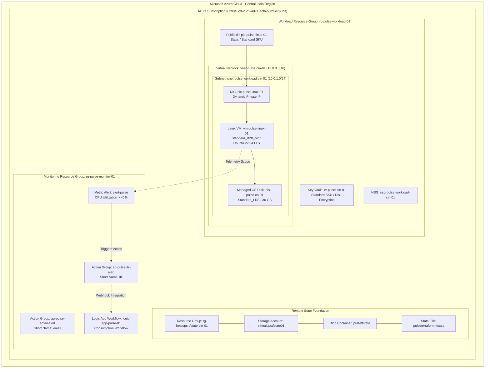
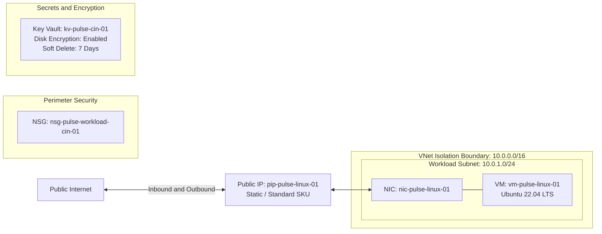
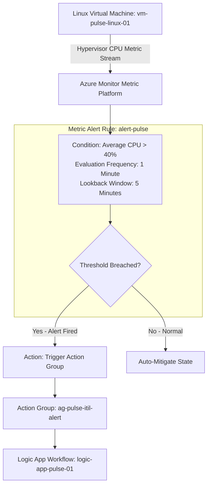
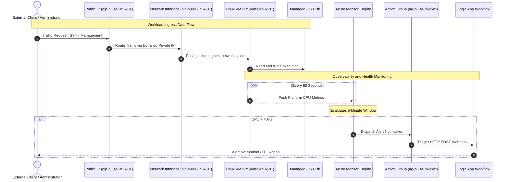

# Azure Architecture & System Flow Diagrams: Project Pulse

This document compiles the visual architecture models representing the actual Azure infrastructure deployed via Terraform.

---

## 1. End-to-End Infrastructure Topology

---

## 2. Network & Security Architecture

---

## 3. Azure Monitor Telemetry & Alerting Pipeline

---

## 4. End-to-End Application & Traffic Sequence

