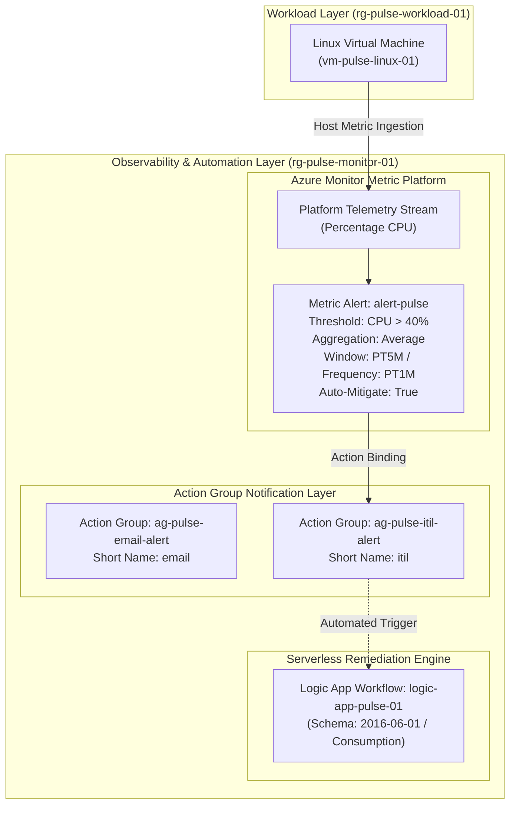
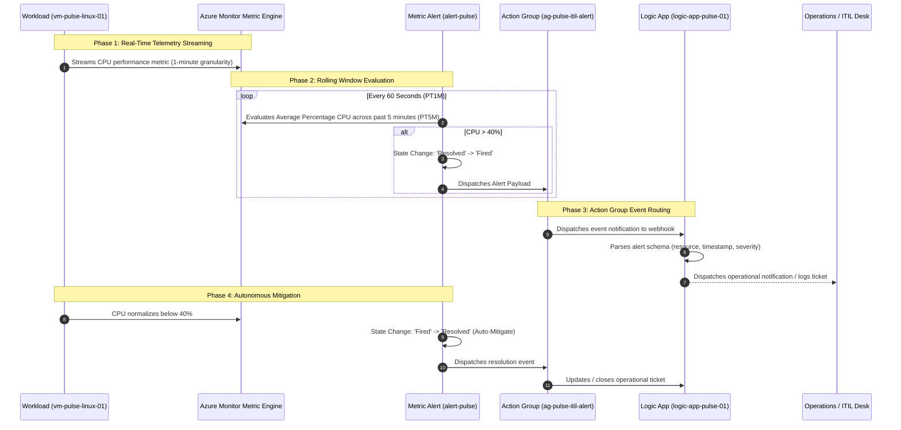

# Azure Monitor & Observability Architecture: Project Pulse

**Project Name:** Project Pulse (HealOps Cloud Platform)  
**Environment:** `dev`  
**Target Region:** Central India (`centralindia`)  
**Scope:** Azure Monitor Metric Engine, Action Groups, Metric Alerting, and Serverless Automation  

---

## 1. Observability Architecture Overview

The **Pulse Observability Framework** implements an automated, event-driven monitoring architecture in Microsoft Azure. Operating entirely within a dedicated monitoring resource group (`rg-pulse-monitor-01`), the system captures telemetry from compute workloads, evaluates real-time performance thresholds, and dispatches targeted alerts across multiple operational channels.

---

## 2. Core Telemetry & Alerting Components

### 2.1 Target Telemetry Scope
* **Monitored Resource:** `vm-pulse-linux-01`
* **Telemetry Mechanism:** Azure Host Hypervisor Metric Stream.
* **Metric Monitored:** `Percentage CPU` (CPU Utilization percentage of the host compute instance).

### 2.2 Metric Alert Engine (`modules/alerts`)
The metric alert `alert-pulse` provides continuous operational surveillance over the compute host:

| Configuration Parameter | Value | Operational Purpose |
| :--- | :--- | :--- |
| **Resource Name** | `alert-pulse` | Formal identifier in Azure Monitor |
| **Target Scope** | `vm-pulse-linux-01` ID | Dedicated binding to the workload VM |
| **Metric Namespace** | `Microsoft.Compute/virtualMachines` | Official Azure compute metric source |
| **Metric Name** | `Percentage CPU` | Processor capacity utilization |
| **Aggregation Method**| `Average` | Smooths transient CPU spikes over the evaluation window |
| **Operator** | `GreaterThan` | Fires when utilization exceeds threshold |
| **Threshold** | `40%` | Baseline performance threshold |
| **Evaluation Frequency**| `PT1M` (1 Minute) | Frequency at which Azure evaluates the rule |
| **Window Size** | `PT5M` (5 Minutes) | Aggregation lookback duration |
| **Auto-Mitigate** | `true` | Automatically resolves alert when CPU returns below 40% |

### 2.3 Multi-Tiered Action Groups (`modules/action_group`)
The platform decouples alert conditions from notification delivery through dedicated Azure Monitor Action Groups:

1. **Email Channel (`ag-pulse-email-alert`):**
   * Configured with short name `email`.
   * Designed for operations and engineering notification streams.
2. **ITIL / Webhook Channel (`ag-pulse-itil-alert`):**
   * Configured with short name `itil`.
   * Wired directly as the target action for `alert-pulse`.
   * Serves as the integration point for automated incident creation and ticketing workflows.

### 2.4 Serverless Workflow Integration (`modules/logic_app`)
* **Resource:** `logic-app-pulse-01` in `rg-pulse-monitor-01`.
* **Capability:** Provides a serverless event listener capable of receiving Common Alert Schema (CAS) payloads from Action Groups, enabling automated self-healing, runbook execution, or third-party ITSM dispatch.

---

## 3. End-to-End Alert Lifecycle & Event Flow

---

## 4. Key Engineering Accomplishments

1. **Decoupled Architecture:** Workloads run safely in `rg-pulse-workload-01` without monitoring configuration overhead, while all observability policies reside in `rg-pulse-monitor-01`.
2. **Autonomous Auto-Mitigation:** The alert automatically clears itself once conditions normalize, eliminating alert noise and manual resolution effort.
3. **Automated Data Discovery:** The monitoring configuration utilizes Terraform's `data "azurerm_virtual_machine"` and `data "azurerm_monitor_action_group"` blocks to dynamically discover resource IDs at runtime, guaranteeing zero hardcoded IDs.
4. **Serverless Extensibility:** The presence of `logic-app-pulse-01` establishes a solid foundation for automated self-healing infrastructure in future operational phases.
