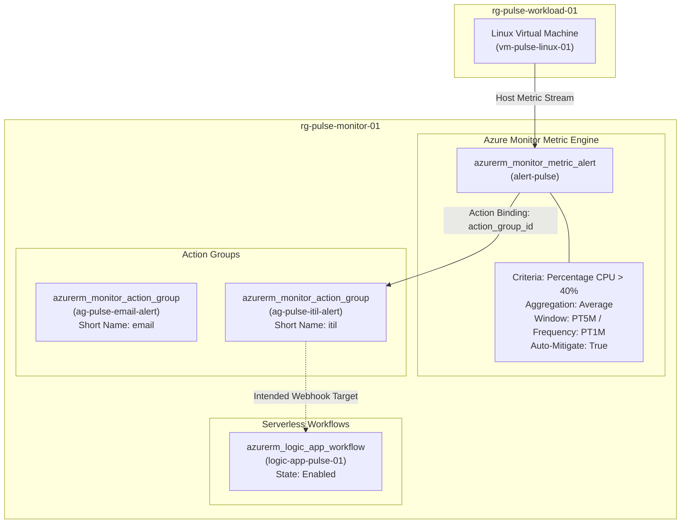
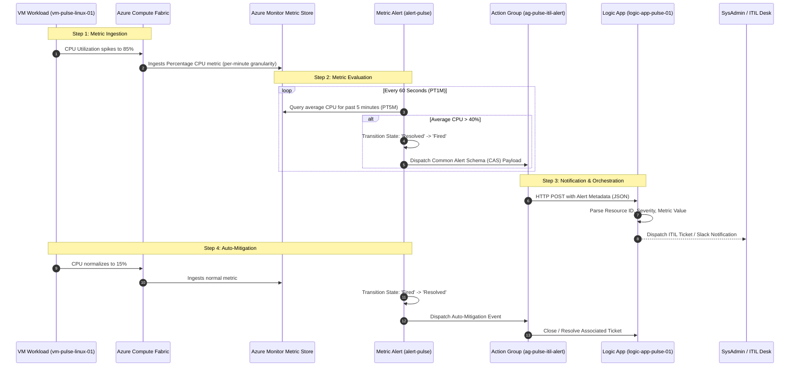
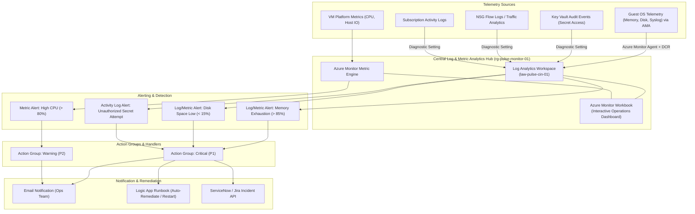

# Azure Monitor & Observability Architecture: Project Pulse

**Document Version:** 1.0.0  
**Status:** Architecture Baseline & Gap Specification  
**Environment:** `dev` (`Central India`)  
**Scope:** Azure Monitor, Metric Alerts, Action Groups, Logic Apps, Log Analytics, Diagnostics, and Dashboards  

---

## 1. Overview & Objectives

This document details the **Observability and Monitoring Architecture** for the Pulse infrastructure. It delineates:
1. **The Current Implementation** as deployed via the Terraform codebase.
2. **The End-to-End Alerting & Notification Workflow**.
3. **The Observability Gap Analysis** (Log Analytics, Diagnostic Settings, Dashboards, and Agent telemetry).
4. **Target Enterprise Observability Blueprint** with implementation specifications.

---

## 2. Current Implementation in Terraform Code

The Terraform configuration currently provisions telemetry and alerting primitives in `rg-pulse-monitor-01`:



### Component Details

1. **Target Monitored Scope:**  
   * Target Resource: Linux VM `vm-pulse-linux-01`.
   * Telemetry Source: Azure Host Hypervisor Metric Stream (platform-level metrics).
2. **Metric Alert Rule (`modules/alerts`):**  
   * Resource Name: `alert-pulse`
   * Target Resource Group: `rg-pulse-monitor-01`
   * Metric Namespace: `Microsoft.Compute/virtualMachines`
   * Metric Name: `Percentage CPU`
   * Operator: `GreaterThan` | Threshold: `40%` | Aggregation: `Average`
   * Evaluation Frequency: Every 1 minute (`PT1M`)
   * Time Window: Past 5 minutes (`PT5M`)
   * Auto-Mitigate: `true` (Automatically resolves the alert when CPU drops below 40%).
3. **Action Groups (`modules/action_group`):**  
   * `ag-pulse-email-alert`: Dedicated container for operational email alerts.
   * `ag-pulse-itil-alert`: Dedicated container for ITIL / ServiceNow / Jira automated incident creation.
4. **Serverless Orchestrator (`modules/logic_app`):**  
   * `logic-app-pulse-01`: Provisioned consumption workflow capable of receiving HTTP webhooks from Azure Monitor and processing automated runbooks.

---

## 3. End-to-End Monitoring & Alerting Workflow

The diagram below illustrates the exact runtime flow from an anomalous workload event through alert resolution:



---

## 4. Observability Gap Analysis (Current vs. Enterprise Target)

While the metric alerting skeleton is in place, the current Terraform codebase exhibits significant enterprise observability gaps:

| Observability Pillar | Status in Codebase | Current Limitation | Target Enterprise Standard |
| :--- | :--- | :--- | :--- |
| **Log Analytics Workspace** | ❌ **Missing** | Zero central log repository. Cannot run KQL queries, store syslog, or retain audit events. | Dedicated `azurerm_log_analytics_workspace` (PerGB2018, 30-90 day retention). |
| **Diagnostic Settings** | ❌ **Missing** | Key Vault audit logs, NSG flow logs, and Activity Logs are discarded. | `azurerm_monitor_diagnostic_setting` on Key Vault, Network, and Subscription. |
| **Guest OS Telemetry** | ❌ **Missing** | Only hypervisor metrics (CPU/Network IO) are monitored. Memory, Disk Free %, and processes are invisible. | Azure Monitor Agent (AMA) VM extension with Data Collection Rules (DCR). |
| **Action Group Receivers** | ⚠️ **Empty Containers** | Action Groups exist as resource shells without `email_receiver` or `webhook_receiver` blocks. | Configured email recipients, SMS, and secure webhook authorization to Logic App. |
| **Dashboards / Workbooks**| ❌ **Missing** | No Azure Workbook or operational dashboard code declared in Terraform. | `azurerm_portal_dashboard` or `azurerm_application_insights_workbook`. |
| **Multi-Resource Scope** | ⚠️ **Static (1:1)** | Alert rule hardcodes single VM ID (`vm1`). Adding `vm2` requires modifying code. | Multi-resource scopes or dynamic `for_each` over all compute workloads. |

---

## 5. Enterprise Target Architecture Blueprint

The following target design outlines the recommended implementation to achieve enterprise-grade observability:



---

## 6. Implementation Specifications for Proposed Improvements

### 6.1 Log Analytics Workspace Specification
```hcl
resource "azurerm_log_analytics_workspace" "law" {
  name                = "law-pulse-cin-01"
  location            = "centralindia"
  resource_group_name = "rg-pulse-monitor-01"
  sku                 = "PerGB2018"
  retention_in_days   = 30
}
```

### 6.2 Key Vault Diagnostic Setting Specification
```hcl
resource "azurerm_monitor_diagnostic_setting" "kv_diag" {
  name                       = "diag-kv-pulse"
  target_resource_id         = module.key_vault.id # or data.azurerm_key_vault.kv.id
  log_analytics_workspace_id = azurerm_log_analytics_workspace.law.id

  enabled_log {
    category = "AuditEvent"
  }

  metric {
    category = "AllMetrics"
    enabled  = true
  }
}
```

### 6.3 Action Group Receivers Specification
```hcl
resource "azurerm_monitor_action_group" "ag" {
  name                = "ag-pulse-itil-alert"
  resource_group_name = "rg-pulse-monitor-01"
  short_name          = "itil"

  email_receiver {
    name                    = "OperationsOnCall"
    email_address           = "ops-alerts@pulse.internal"
    use_common_alert_schema = true
  }

  logic_app_receiver {
    name                    = "LogicAppWebhook"
    resource_id             = module.logic_app.id
    callback_url            = module.logic_app.callback_url
    use_common_alert_schema = true
  }
}
```

### 6.4 Key Recommended Metrics & Alerting Matrix

| Alert Name | Target Resource | Metric / Query | Threshold | Window | Severity | Action Group |
| :--- | :--- | :--- | :--- | :--- | :--- | :--- |
| **High CPU Alert** | `vm-pulse-linux-01` | `Percentage CPU` | `> 80%` | 5 Min | Sev 2 (Warning) | `ag-pulse-itil-alert` |
| **Memory Pressure** | `vm-pulse-linux-01` | `Available Memory Bytes` | `< 10%` | 5 Min | Sev 1 (Error) | `ag-pulse-itil-alert` |
| **Disk Space Low** | `vm-pulse-linux-01` | `Used Disk Space %` | `> 85%` | 15 Min | Sev 1 (Error) | `ag-pulse-itil-alert` |
| **VM Unavailability** | `vm-pulse-linux-01` | `VmAvailabilityMetric` | `< 1` | 1 Min | Sev 0 (Critical) | `ag-pulse-email-alert` |
| **Key Vault Access Failure** | `kv-pulse-cin-01` | `AuditEvent` status 403 | `> 5 in 5m` | 5 Min | Sev 1 (Error) | `ag-pulse-email-alert` |
