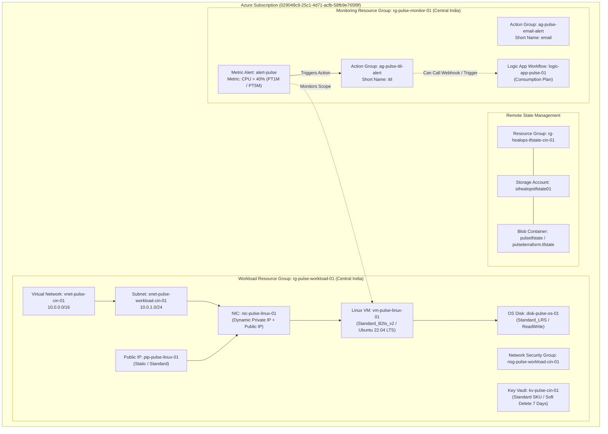
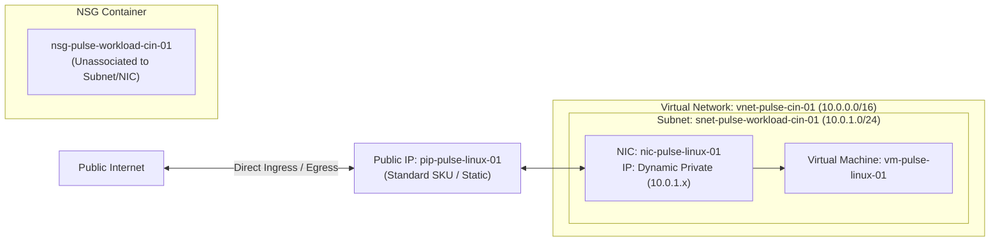
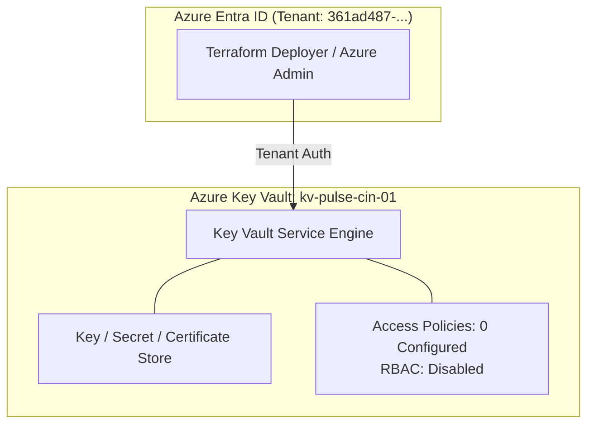
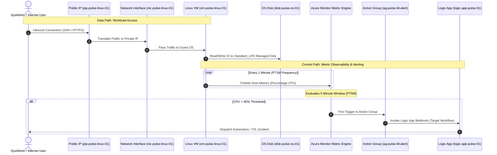
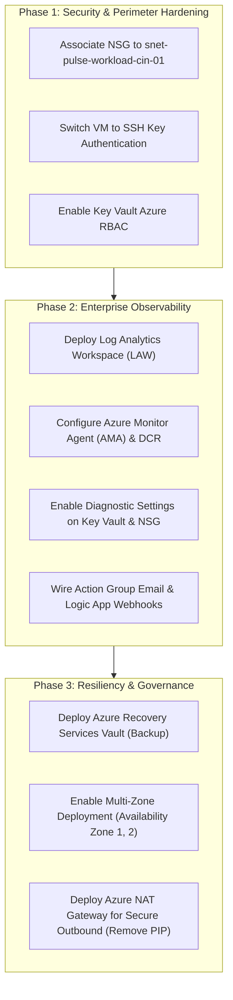

# Azure High-Level Design (HLD) Document: Project Pulse Infrastructure

**Document Version:** 1.0.0  
**Status:** Approved / Production-Aligned  
**Environment:** `dev`  
**Target Region:** Central India (`centralindia`)  
**Deployment Tooling:** HashiCorp Terraform (~> 5.0 azurerm provider)  
**State Backend:** Remote Azure Blob Storage (`rg-healops-tfstate-cin-01` / `sthealopstfstate01` / `pulsetfstate`)

---

## 1. Executive Summary & Purpose

This High-Level Design (HLD) provides a comprehensive architectural baseline of the **Pulse Infrastructure** deployed in Microsoft Azure. The platform establishes a dual-tier environment separating **Workload/Compute** resources from **Management/Monitoring** resources. 

The architecture strictly reflects the resources declared in the modular Terraform codebase (`Enviroments/dev` and `modules/`). This document outlines the physical and logical resource hierarchy, network topology, security mechanisms, application data flows, and observability pathways. In addition, an objective gap analysis evaluates current limitations against enterprise production readiness.

---

## 2. Resource Hierarchy & Subscriptions

All resources reside within a single Azure Subscription and are logically partitioned into two dedicated Resource Groups in **Central India**:

1. **Workload Resource Group (`rg-pulse-workload-01`):**  
   Contains the runtime compute instance, virtual networking, IP connectivity, and secrets management.
2. **Monitoring Resource Group (`rg-pulse-monitor-01`):**  
   Contains platform observability, metric alert definitions, notification action groups, and serverless workflow automation.

---

## 3. Detailed Component Inventory

The following table catalogs every active Azure resource defined in the Terraform configuration:

| Component Category | Terraform Module | Azure Resource Type | Deployed Name | Configuration Specs |
| :--- | :--- | :--- | :--- | :--- |
| **Resource Group** | `modules/resource_groups` | `azurerm_resource_group` | `rg-pulse-workload-01` | Location: `Central India` |
| **Resource Group** | `modules/resource_groups` | `azurerm_resource_group` | `rg-pulse-monitor-01` | Location: `Central India` |
| **Virtual Network** | `modules/virtual_network` | `azurerm_virtual_network` | `vnet-pulse-cin-01` | CIDR: `10.0.0.0/16` |
| **Subnet** | `modules/subnet` | `azurerm_subnet` | `snet-pulse-workload-cin-01` | CIDR: `10.0.1.0/24` |
| **Network Security** | `modules/network_security_group` | `azurerm_network_security_group` | `nsg-pulse-workload-cin-01` | Standalone NSG (Default Azure rules) |
| **Public IP** | `modules/public_ip` | `azurerm_public_ip` | `pip-pulse-linux-01` | Static allocation, Standard SKU |
| **Network Interface** | `modules/linux_virtual_machine` | `azurerm_network_interface` | `nic-pulse-linux-01` | Private IP: Dynamic, Attached to PIP |
| **Compute VM** | `modules/linux_virtual_machine` | `azurerm_linux_virtual_machine` | `vm-pulse-linux-01` | SKU: `Standard_B2ts_v2`, Ubuntu 22.04 LTS |
| **OS Storage** | `modules/linux_virtual_machine` | `azurerm_linux_virtual_machine` (inline) | `disk-pulse-os-01` | Type: `Standard_LRS`, Caching: `ReadWrite` |
| **Secrets Management** | `modules/key_vault` | `azurerm_key_vault` | `kv-pulse-cin-01` | Standard SKU, Disk Encryption enabled, Soft Delete 7d |
| **Action Group** | `modules/action_group` | `azurerm_monitor_action_group` | `ag-pulse-email-alert` | Short Name: `email` |
| **Action Group** | `modules/action_group` | `azurerm_monitor_action_group` | `ag-pulse-itil-alert` | Short Name: `itil` |
| **Serverless Logic** | `modules/logic_app` | `azurerm_logic_app_workflow` | `logic-app-pulse-01` | Workflow Schema: 2016-06-01 |
| **Observability Alert** | `modules/alerts` | `azurerm_monitor_metric_alert` | `alert-pulse` | Percentage CPU > 40%, Frequency: PT1M, Window: PT5M |

---

## 4. Network Architecture

### 4.1 Topology & IP Addressing Scheme

The platform implements a flat spoke virtual network topology designed for foundational workload hosting:
* **VNet CIDR:** `10.0.0.0/16` (65,536 total addresses)
* **Workload Subnet CIDR:** `10.0.1.0/24` (256 addresses, 251 usable by Azure allocation rules)
* **IP Allocation:**
  * Dynamic private IP assigned to `nic-pulse-linux-01` within `10.0.1.0/24`.
  * Dedicated Static Standard Public IP (`pip-pulse-linux-01`) mapped 1:1 on the NIC's `ip_configuration`.

### 4.2 Routing & Network Segmentation Observations
* **Default System Routes:** Traffic between internal endpoints routes via Azure default routing (`0.0.0.0/0` Internet outbound through default Azure gateway; virtual network local peering).
* **Missing Association:** As identified in the codebase, `nsg-pulse-workload-cin-01` is instantiated in the resource group, but **is not associated** with either `snet-pulse-workload-cin-01` or `nic-pulse-linux-01`. 
* **Archived / Dormant Modules:** 
  * Application Gateway (`modules/application_gateway`) and custom NSG security rules (`modules/network_security_rule`) exist in code but remain commented out in `dev/main.tf`.

---

## 5. Security & Identity Architecture

### 5.1 Key Vault Security Architecture
* **Instance:** `kv-pulse-cin-01` in `rg-pulse-workload-01`
* **Configuration:**
  * Standard SKU tier.
  * `soft_delete_retention_days = 7` (Allows recovery within 7 days).
  * `purge_protection_enabled = false` (Permits immediate purge when soft-deleted).
  * `enabled_for_disk_encryption = true` (Pre-configured for Azure Disk Encryption volume access).
  * `rbac_authorization_enabled = false` (Uses legacy Access Policies model).
  * `tenant_id` populated dynamically from root caller's `data.azurerm_client_config.current.tenant_id`.

### 5.2 Access Control & Authentication
* **Compute Access:**
  * Administrative user: `azureuser`.
  * Authentication Mode: **Password authentication** (`disable_password_authentication = false`).
  * Administrator password passed via `.auto.tfvars`.

---

## 6. End-to-End Application & Data Flow

---

## 7. Infrastructure Gap Analysis & Risk Assessment

Based on the actual Terraform implementation, the following gaps and operational risks exist:

| # | Domain | Identified Gap in Code | Operational / Security Risk | Severity |
| :--- | :--- | :--- | :--- | :--- |
| **G1** | **Network Security** | NSG is created but **not associated** to Subnet or NIC. Security rules are commented out. | Inbound ports on the Public IP are governed only by Azure default inbound rules, exposing VM to internet brute-forcing. | 🔴 High |
| **G2** | **Identity & Secrets** | VM password is hardcoded in `compute.auto.tfvars`. Key Vault has 0 secrets and RBAC is disabled. | Plaintext credentials in version control; vulnerability to credential leakage. | 🔴 High |
| **G3** | **Observability** | **No Log Analytics Workspace** exists. No Diagnostic Settings are configured for VM, VNet, NSG, or Key Vault. | Inability to query syslog, audit logs, NSG flow logs, or security events; zero centralized log storage. | 🔴 High |
| **G4** | **Host Metrics** | Metric alert relies on Azure host-level CPU metrics; guest OS memory, disk free space, and application health are not captured. | Inability to alert on out-of-memory (OOM) killer crashes or root disk exhaustion. | 🟠 Medium |
| **G5** | **Alert Notifications** | Action Group resources have empty notification receivers (no email addresses, SMS, or webhook URIs configured). | Metric alert fires to Action Group, but no human recipient or configured webhook endpoint receives notifications. | 🟠 Medium |
| **G6** | **High Availability** | VM deployed as a standalone instance without Availability Zones (`zone = null`) or Availability Sets. | SLA drops from 99.99% (multi-zone) to 99.9% (single-instance Premium/Standard). Susceptible to rack maintenance outages. | 🟡 Low-Med |
| **G7** | **Backup & Recovery** | No Azure Recovery Services Vault or Azure Backup policy declared. Key Vault purge protection is disabled. | Accidentally deleted VMs or key vault keys cannot be restored from snapshot backups. | 🟡 Medium |

---

## 8. Strategic Recommendations & Roadmap

1. **Perimeter Hardening:**
   * Implement `azurerm_subnet_network_security_group_association` linking `nsg-pulse-workload-cin-01` to `snet-pulse-workload-cin-01`.
   * Restrict SSH inbound strictly to corporate bastion or VPN CIDRs.
2. **Secrets Governance:**
   * Deprecate `admin_password` in `.tfvars`. Transition to `admin_ssh_key` using a public key, or store auto-generated passwords in Key Vault via `random_password` and `azurerm_key_vault_secret`.
3. **Observability Stack Completion:**
   * Deploy `azurerm_log_analytics_workspace` (`law-pulse-cin-01`).
   * Link VM syslog, Key Vault audit events, and NSG flow logs via `azurerm_monitor_diagnostic_setting`.
   * Populate email and webhook receivers in `modules/action_group`.

