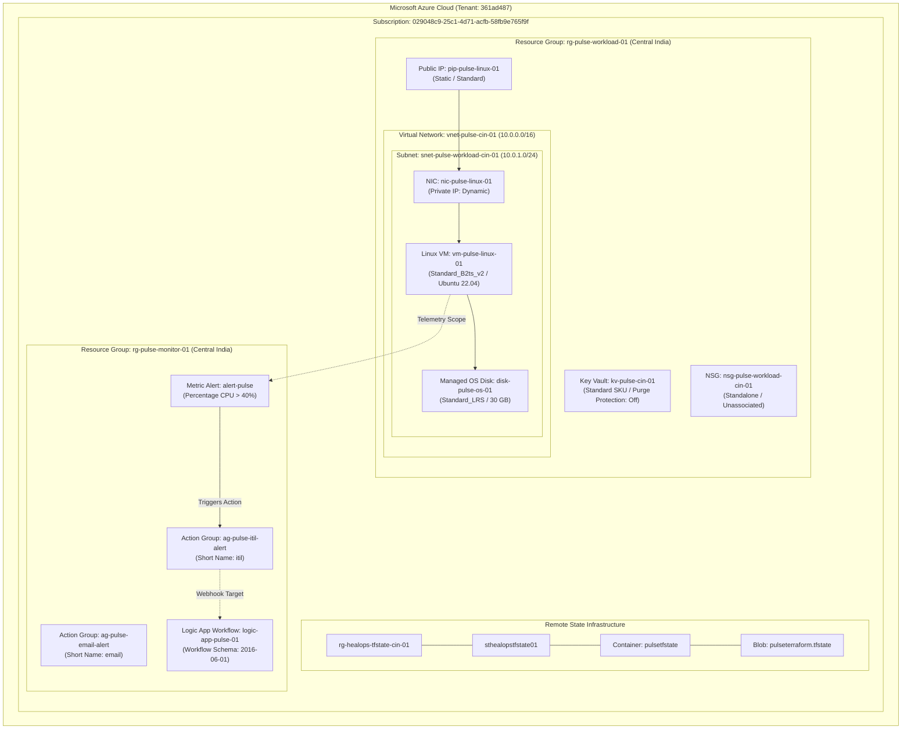
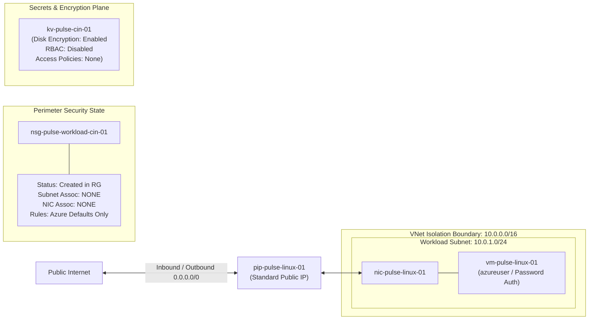
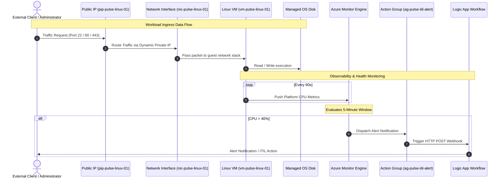

# Azure Architecture & System Flow Diagrams: Project Pulse

This document compiles the visual architecture models representing the actual Azure infrastructure deployed via Terraform.

---

## 1. End-to-End Infrastructure Topology



---

## 2. Network & Security Segmentation Model



---

## 3. Azure Monitor Telemetry & Alerting Pipeline

```mermaid
flowchart TD
    VM["Linux Virtual Machine: vm-pulse-linux-01"] -->|Hypervisor CPU Metric| METRIC_STORE["Azure Monitor Metric Platform"]
    
    subgraph EvaluationEngine["Metric Alert Rule: alert-pulse"]
        CRITERIA["Condition: Average CPU > 40%<br/>Evaluation Frequency: 1 Minute (PT1M)<br/>Window Size: 5 Minutes (PT5M)"]
        STATUS_EVAL{"Threshold Breached?"}
    end

    METRIC_STORE --> CRITERIA
    CRITERIA --> STATUS_EVAL

    STATUS_EVAL -->|Yes (Fired)| TRIGGER_AG["Action: Trigger ag-pulse-itil-alert"]
    STATUS_EVAL -->|No (Resolved)| MITIGATE["Auto-Mitigate State"]

    TRIGGER_AG --> ACTION_GROUP["Action Group: ag-pulse-itil-alert"]
    ACTION_GROUP --> LOGIC_APP["Logic App Workflow: logic-app-pulse-01"]
```

---

## 4. End-to-End Application & Traffic Sequence



